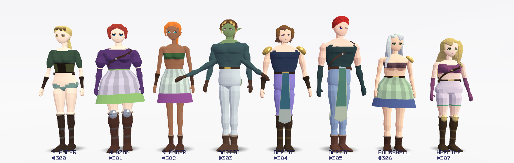
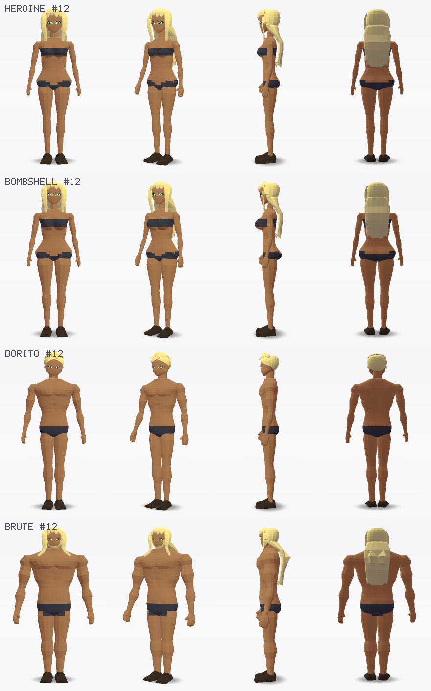
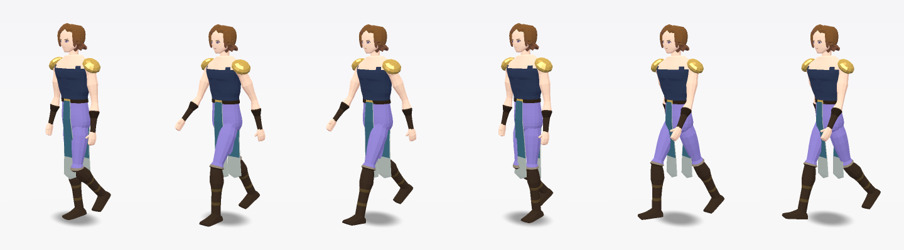

# chargen — gerador procedural de personagens low-poly (C++20)

Gerador de personagens para um ARPG de fantasia: corpos com proporções humanas puxadas para o lado
RPG/anime (violão, *dorito*, *bombshell*, brutamontes, amazona, élfica esguia, monstros de 4 braços),
rosto 2D reativo (olhos e boca trocáveis em tempo de execução), esqueleto simples com skinning suave,
animações procedurais com movimento secundário e exportação glTF pronta para engine.

Sem dependências externas: só a biblioteca padrão de C++20 (o encoder PNG e o renderizador de
preview também foram escritos aqui).

| Elenco (`lineup`) | Corpos base (`sheet --base`) |
|---|---|
|  |  |

| Rostos (`portraits`) | Expressões (`faces`) |
|---|---|
|  |  |



## Compilar

```bash
cmake -S . -B build -G Ninja -DCMAKE_BUILD_TYPE=Release
cmake --build build
./build/chargen_tests          # determinismo, malha válida, pesos, winding, export
```

## CLI

```bash
chargen_cli lineup    --seed 300 --count 8            # elenco lado a lado
chargen_cli sheet     --seed 12 --archetype bombshell # turnaround: frente, 3/4, perfil, costas
chargen_cli sheet     --seed 12 --archetype brute --base   # só roupa íntima (avaliar anatomia)
chargen_cli portraits --seed 200 --count 12           # variedade de rostos/cabelos
chargen_cli faces     --seed 301                      # folha de emoções
chargen_cli anim      --seed 304 --clip walk --frames 6 [--yaw 0.9]
chargen_cli atlas     --seed 5                        # atlas facial 2D
chargen_cli export    --seed 42 --lod 0 --out heroi.glb
chargen_cli stats     --count 300                     # tempo e triângulos por LOD
```

Opções comuns: `--archetype heroine|bombshell|dorito|brute|slender|chibi|amazon|monster`,
`--exaggeration 0..2` (empurra proporções para o caricato/absurdo), `--smooth` (normais suaves em vez
de facetado), `--toon` (preview com cel shading e contorno).

## Como funciona

```
Genome (DNA)  ──►  Builder  ──►  Character { Skeleton, RigInfo, Mesh, Image faceAtlas }
                                       │
             animation.hpp  ◄──────────┤  clips procedurais + skinning CPU
             gltf.hpp       ◄──────────┤  .glb (skin, animações, atlas embutido)
             render.hpp     ◄──────────┘  preview em software (PNG)
```

### Genoma (`include/chargen/genome.hpp`)
Todas as medidas do corpo são em **unidades de cabeça** (`h = altura / headsTall`), o que mantém as
proporções coerentes de chibi a brutamontes. Cada arquétipo define faixas (altura, nº de cabeças,
razão das pernas, ombro/peito/cintura/quadril, busto, glúteos, músculo, barriga, espessura de
membros...). `randomGenome(seed)` é determinístico e usa *sub-streams* independentes por aspecto
(corpo, rosto, cabelo, roupa, paleta): adicionar um parâmetro novo não embaralha os outros.

### Corpo esculpido por lofts
Cada parte é um *loft* de anéis superelípticos ao longo dos ossos (frente e costas com profundidades e
expoentes independentes), soldado numa única malha:

- **Torso** (`Builder::torsoPoint`): uma superfície contínua da virilha ao pescoço com curvas
  monotônicas (sem overshoot) para largura/profundidade, postura em S, e esculpidos aditivos:
  seios (calota elíptica com dobra inferior, integrada ao torso, não esferas coladas), glúteos com
  sulco, peitoral com borda definida, abdômen em placas, dorsais em V, trapézio, sulco da coluna,
  escápulas e eretores. A amostragem angular é mais densa na frente/costas, onde estão as curvas.
- **Membros**: o loft do braço dobra no ombro e corre para o pescoço, formando o deltoide como
  parte do braço (sem "ombro de bola"); bíceps/tríceps, antebraço, quadríceps e panturrilha
  crescem com o músculo. O topo da coxa é preso por dentro da pelve, então quadril e coxa formam
  uma linha contínua.
- **Cabeça**: perfil anime com variação individual de mandíbula, queixo e maçãs do rosto; sempre
  com sombreamento liso para o rosto 2D não ficar "facetado".
- **Pesos de skinning** vêm do parâmetro do loft ao longo da cadeia de ossos (blend suave nas
  articulações), mais influência dos ossos de busto e de clavícula onde faz sentido.
- Cada quad é dividido pela diagonal mais coplanar, o que reduz lascas no estilo facetado.

### Rosto 2D reativo
O rosto é pintado (SDF com anti-aliasing) num atlas 1024×512: 8 células de olhos
(`neutral, blink, happy, angry, sad, surprised, hurt, smug`) e 8 de boca
(`neutral, smile, open, grin, frown, shout, oh, smirk`). Dois *decals* finos acompanham a superfície
da cabeça e apontam para as células `Neutral`; uma expressão é só um offset de UV:

```cpp
cg::FaceState f = cg::emotionFace(cg::Emotion::Rage);      // {Angry, Shout}
cg::Vec2 eyeOff   = cg::FaceLayout::eyeUvOffset(f.eyes);   // some aos UVs do material face_eyes
cg::Vec2 mouthOff = cg::FaceLayout::mouthUvOffset(f.mouth); // some aos UVs do material face_mouth
```

Olhos e boca combinam livremente (8×8). Cada personagem tem formato de olho próprio (amendoado,
redondo, encapuzado, puxado, caído), maturidade (de anime jovem a semi-realista), sobrancelhas,
lábios, nariz, sombra nos olhos, sardas e cicatriz. As animações trazem uma trilha de expressão
(piscar no idle, raiva no ataque).

### Esqueleto e animação
`root → hips → spine → chest → neck → head`, clavícula/braço/antebraço/mão por braço (2 ou 4 braços),
coxa/canela/pé/dedo, ossos opcionais de busto, cauda (4) e rabo de cavalo/trança (3). Rotações de
repouso são identidade (A-pose), o que simplifica a autoria procedural. Clipes: `idle`, `walk`, `run`,
`attack`, mais molas amortecidas simuladas em loop para busto, cabelo e cauda.

```cpp
cg::Character c = cg::generateCharacter(cg::randomGenome(42));
cg::Clip walk = cg::makeWalkClip(c);
cg::Pose pose = cg::sampleClip(walk, t);
std::vector<cg::Mat4> global, skin;
cg::poseMatrices(c.skeleton, pose, global, skin);   // paleta de matrizes para o shader de skinning
```

### Exportação glTF
`exportGlb` grava um `.glb` com 3 primitivas (`body` com cor por vértice, `face_eyes` e `face_mouth`
com o atlas e `alphaMode: MASK`), skin, as 4 animações e o layout do atlas em `extras`. O alfa de
`COLOR_0` guarda a classe do material (`pele, tecido, couro, metal, cabelo, escuro, chifre`) para o
shader escolher tom de sombra/especular sem texturas extras.

## Desempenho (4 núcleos, Release)

| | triângulos | tempo/personagem |
|---|---|---|
| LOD0 | ~5.500 | ~34 ms (malha < 1 ms; o resto é pintar o atlas, em paralelo) |
| LOD1 | ~3.200 | ~30 ms |
| LOD2 | ~2.400 | ~30 ms |

Num jogo, a malha pode ser gerada no spawn e o atlas pintado em uma *thread* de fundo (ou cacheado
por personagem). O modo facetado duplica vértices por face; para economizar memória, exporte com
`--smooth` e faça o facetado no shader (`normalize(cross(dFdx(pos), dFdy(pos)))`).

## Estrutura

```
include/chargen/  math, rng, genome, character, animation, image, render, gltf
src/              genome.cpp (arquétipos, paletas), builder.* (lofts, solda, pesos),
                  generator.cpp (corpo/roupas), hair.cpp (cabelo, chifres, orelhas, barba),
                  face.cpp (atlas facial), animation.cpp, render.cpp, gltf.cpp, image.cpp
apps/chargen_cli.cpp   tests/tests.cpp   docs/ (imagens geradas pela CLI)
```

## Próximos passos naturais
- Bestas e anatomias únicas: pernas digitígradas, asas, quadrúpedes (o `BodyPlan` de membros já é
  genérico: braços extras e cauda usam o mesmo construtor de loft).
- Morph targets (respiração, flexão de músculo, volume do busto) exportados no glTF.
- Mais estilos de cabelo/roupa como dados; LOD automático por distância; viewer em tempo real.
